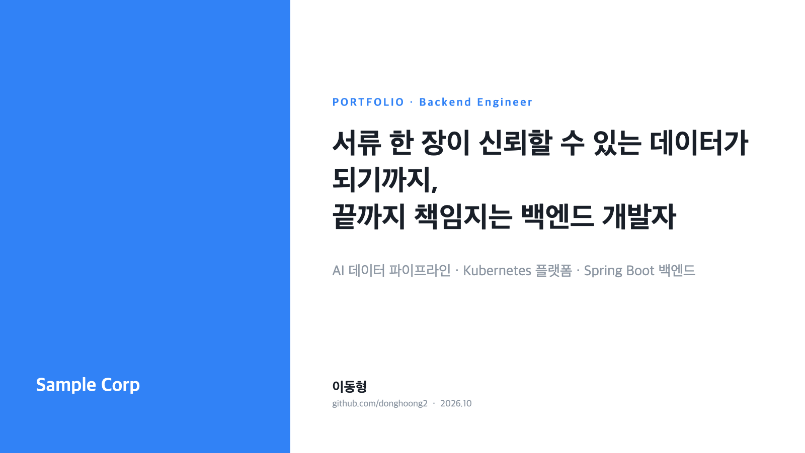
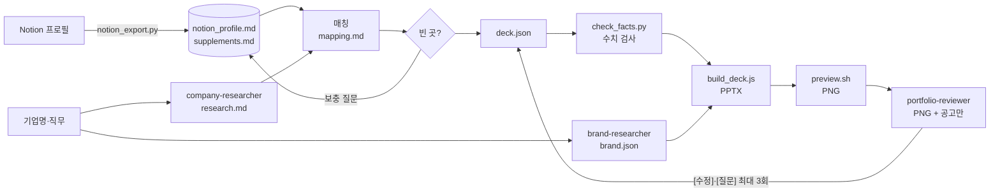

<div align="center">

# 기업 맞춤 포트폴리오 생성기

**기업 이름 하나로, 그 회사의 인재상·채용공고·브랜드에 맞춘 포트폴리오 PPTX를 만든다.**

[](https://claude.com/claude-code)
[](https://gitbrent.github.io/PptxGenJS/)
[](https://www.python.org/)



<sub>`companies/_sample`로 만든 표지. 브랜드 컬러·폰트·레이아웃은 기업마다 `brand.json`으로 바뀐다.</sub>

</div>

```text
/company-portfolio 토스 백엔드
```

---

## 목차

- [왜 만들었나](#왜-만들었나)
- [주요 기능](#주요-기능)
- [빠른 시작](#빠른-시작)
- [사용법](#사용법)
- [동작 방식](#동작-방식)
- [결과물](#결과물)
- [사실 검증 원칙](#사실-검증-원칙)
- [프로젝트 구조](#프로젝트-구조)
- [커스터마이징](#커스터마이징)
- [문제 해결](#문제-해결)
- [참고](#참고)

## 왜 만들었나

같은 경험이라도 금융사에는 정합성·보안을, 커머스에는 트래픽·성능을, AI 기업에는 데이터 파이프라인을 앞세워야 한다. 그런데 기업마다 포트폴리오를 새로 짜면 시간이 많이 들고, 급하게 맞추다 보면 경험을 부풀리기 쉽다.

이 도구는 **경험은 그대로 두고, 무엇을 앞에 둘지와 어떤 말로 보여줄지만 기업에 맞춘다.** 결과물은 그 기업 면접관의 눈으로 다시 검토한다.

## 주요 기능

| | 기능 | 설명 |
|---|---|---|
| 🔎 | **기업 조사** | 인재상·핵심가치, 채용공고(주요업무/지원자격/우대사항), 기술 스택, 최근 이슈를 출처와 함께 정리 |
| 🎨 | **브랜드 테마** | 공식 컬러 HEX, 전용/대체 폰트, 디자인 톤을 조사해 덱 테마 토큰으로 변환. 명도 대비는 자동으로 확인 |
| 🧩 | **경험 매칭** | 인재상·요건마다 가장 강한 근거를 짝짓고 `충족 / 부분 충족 / 미충족`으로 표시. 기업이 쓰는 어휘를 그대로 사용 |
| 🙋 | **보충 질문** | 프로필에 없는 원인·전후 수치·선택 이유를 한 번에 묻고 누적. 다음 기업 덱에서도 재사용 |
| 🛡️ | **수치 검사** | 덱의 모든 수치를 사실 출처와 대조. 출처에 없는 숫자가 하나라도 있으면 빌드하지 않음 |
| 🧑‍💼 | **면접관 리뷰** | 슬라이드와 채용공고만 보는 블라인드 리뷰어가 7개 기준으로 채점하고, 최대 3회 고친 뒤 다시 평가 |
| 🗣️ | **발표자 노트** | 슬라이드마다 면접에서 말할 30초 설명 포함 |

## 빠른 시작

**요구 사항:** [Claude Code](https://claude.com/claude-code), Node.js, Python 3.10+, 미리보기 렌더러(LibreOffice + poppler 권장, 또는 Keynote)

```bash
git clone https://github.com/donghoong2/company-portfolio.git
cd company-portfolio
npm install

# 미리보기 렌더러 (macOS). 면접관 리뷰는 미리보기 PNG가 있어야 돌아간다
brew install --cask libreoffice && brew install poppler
```

1. **Notion 프로필을 공개한다.** 프로필 페이지 → 공유 → 웹에 게시. 프로젝트·활동 DB와 하위 페이지까지 함께 내보낸다.
2. **프로필 URL을 바꾼다.** `.claude/skills/company-portfolio/SKILL.md`의 "0. 준비"에 있는 URL을 내 페이지 주소로 바꾼다.
3. **Claude Code를 실행한다.**
   ```bash
   claude
   > /company-portfolio 토스 백엔드
   ```

## 사용법

```text
/company-portfolio <기업명> [직무] [채용공고 URL]
```

| 예시 | 동작 |
|---|---|
| `/company-portfolio 토스` | 기본 직무(프로필의 직무)로 토스 덱 생성 |
| `/company-portfolio 네이버 데이터엔지니어` | 직무를 지정. 작업 폴더는 `companies/naver-data/` |
| `/company-portfolio 카카오뱅크 백엔드 https://...` | 채용공고 URL을 가장 먼저 조사 |
| `노션 새로고침하고 토스 포트폴리오 다시 만들어줘` | 프로필을 다시 내보낸 뒤 생성 |

진행 중에는 두 번 질문을 받는다. 덱을 만들기 전의 **보충 질문**과, 리뷰 루프 중 사실 확인이 필요한 **[질문] 지적**이다. 모르는 항목은 "모름", 고치지 않을 항목은 "그대로 둘게요"라고 답하면 다시 묻지 않는다.

## 동작 방식



| 단계 | 담당 | 산출물 |
|---|---|---|
| 1. 프로필 수집 | `scripts/notion_export.py` | `profile/notion_profile.md` |
| 2. 기업 조사 (병렬) | `company-researcher`, `brand-researcher` 서브에이전트 | `research.md`, `brand.json` |
| 3. 매칭 | 메인 에이전트 | `mapping.md` |
| 4. 보충 질문 | 메인 에이전트 ↔ 사용자 | `profile/supplements.md` |
| 5. 덱 작성 | 메인 에이전트 | `deck.json` |
| 6. 수치 검사 | `scripts/check_facts.py` | 통과 / 실패 목록 |
| 7. 렌더링 | `scripts/build_deck.js` (pptxgenjs) | `output/<slug>_portfolio.pptx` |
| 8. 시각 검수 | `scripts/preview.sh` | `output/preview/<slug>_portfolio/*.png` |
| 9. 면접관 리뷰 (최대 3회) | `portfolio-reviewer` 서브에이전트 | `review/reviewer-<n>.md`, `loop.md` |

<details>
<summary><b>면접관 리뷰 루프 자세히</b></summary>

리뷰어는 **슬라이드 PNG와 채용공고(`review/posting.md`)만** 받는다. 작성 의도, 매칭 분석, 프로필은 받지 않는다. 실제 면접관도 덱 밖의 사실은 모르기 때문이다.

**평가 기준 (각 5점, 합계 35점)**
1. 문제 발견 → 원인 분석 → 해결 과정
2. 결과의 구체성과 근거(측정 조건)
3. 대안 비교와 선택 이유
4. 공고의 직무·자격·우대사항 충족
5. 인재상·일하는 방식 적합성
6. 30초 안에 핵심이 파악되는지
7. 오류·모순·과장이 없는지

**한 회차의 흐름**
1. **인용 확인:** 리뷰어가 인용한 문장이 덱에 실제로 있는지 `check_facts.py --find`로 확인한다. 없으면 PNG를 직접 열어 본다.
2. **거절 걸러내기:** 사용자가 이미 "그대로 둘게요"라고 한 지적을 뺀다.
3. **`[수정]`:** 덱 안의 사실만으로 고칠 수 있는 지적은 바로 고친다.
4. **`[질문]`:** 사실 출처에서 답을 먼저 찾고, 없는 것만 사용자에게 한 번에 묻는다.
5. **다시 만들기:** 수치 검사 → 빌드 → 미리보기를 다시 거친다.

남은 지적이 0개가 되거나 3회가 끝나면 멈춘다.

</details>

## 결과물

슬라이드는 12~18장이고, 아래 타입을 조합해 만든다. 필드 정의는 [`reference/schemas.md`](.claude/skills/company-portfolio/reference/schemas.md)에 있다.

| 타입 | 내용 |
|---|---|
| `cover` | 기업 인재상과 나의 정체성을 합친 헤드라인 |
| `profile` | 소개, 인재상 키워드, 핵심 역량 3개 |
| `fit` | 인재상 × 나의 경험 근거 |
| `requirements` | 지원자격·우대사항 매칭 표 |
| `section` · `project` | 프로젝트 간지와 개요(지표, 기여, 기술 스택) |
| `star` | 트러블슈팅: 상황 → 문제 → 행동 → 결과 |
| `architecture` · `image` | 구조도, 이미지 |
| `activities` · `skills` | 활동 이력, 기술 스택(기업 스택과 겹치는 것을 앞에) |
| `closing` | 기업에 대한 한 문장 포부 |

## 사실 검증 원칙

> 지원자 경험·수치는 `profile/notion_profile.md`와 `profile/supplements.md`에 있는 것만 쓴다.
> 과장·창작하지 않고, 팀 성과는 팀 성과로 표기한다.

- **미충족 요건은 숨기지 않는다.** `mapping.md`에 표시하고 사용자에게 보고한다. 덱에는 넣지 않는다.
- **계산값에는 근거를 남긴다.** 출처 수치로 계산한 값(감소율 등)은 `deck.json`의 `derived`에 근거를 적어야 수치 검사를 통과한다.
  ```json
  "derived": [{ "value": "42.2", "from": "52.6분 → 30.4분" }]
  ```
- **보충 답변에는 출처를 붙인다.** `supplements.md`의 답변마다 `(출처: 사용자, 날짜, 기업)`을 남긴다. 모르는 값은 `(모름)`으로 적어 다시 묻지 않는다.

```bash
python3 scripts/check_facts.py companies/<slug>                 # 수치 검사
python3 scripts/check_facts.py companies/<slug> --find "<문장>"  # 문장이 몇 번 슬라이드에 있는지
```

> [!NOTE]
> 수치 검사는 숫자가 출처 어딘가에 있는지만 본다. 0~50 같은 작은 정수는 거의 항상 통과하므로, 맥락이 맞는지는 리뷰어의 7번 기준(오류·모순)이 보완한다.

## 프로젝트 구조

```text
.claude/
├─ agents/
│  ├─ company-researcher.md   인재상·채용공고 조사
│  ├─ brand-researcher.md     브랜드 컬러·폰트·톤 조사
│  └─ portfolio-reviewer.md   블라인드 면접관 리뷰
└─ skills/company-portfolio/
   ├─ SKILL.md                전체 절차
   └─ reference/schemas.md    brand.json · deck.json 스키마
scripts/
├─ notion_export.py           공개 Notion 페이지 → Markdown
├─ check_facts.py             덱 수치 ↔ 사실 출처 대조
├─ build_deck.js              brand.json + deck.json → PPTX
└─ preview.sh                 PPTX → PNG (LibreOffice 또는 Keynote)
profile/                      notion_profile.md, supplements.md         (gitignore)
companies/<slug>/             research.md, brand.json, mapping.md,
                              deck.json, assets/, review/              (gitignore)
companies/_sample/            스키마 예시
output/                       <slug>_portfolio.pptx, preview/          (gitignore)
```

개인 지원 자료(`profile/`, `companies/<기업>/`, `output/`)는 `.gitignore`로 제외한다.

## 커스터마이징

- **디자인:** `brand.json`의 `style`만 바꿔도 덱 인상이 달라진다.
  - `corner`: `rounded` / `sharp` / `pill`
  - `coverStyle`: `split` / `solid` / `minimal`
  - `sectionStyle`: `solid` / `light`
  - `markColor`: `primary` / `accent`
- **내용:** `deck.json`을 고친 뒤 다시 빌드한다.
  ```bash
  python3 scripts/check_facts.py companies/<slug> && node scripts/build_deck.js companies/<slug>
  ```
- **새 레이아웃:** 꼭 필요할 때만 `build_deck.js`에 slide 타입을 추가하고 `schemas.md`도 같이 고친다.

## 문제 해결

| 증상 | 해결 |
|---|---|
| `⚠️ 폰트 미설치: "…" → "…"로 대체` | 브랜드 폰트는 자동 설치하지 않는다. `brand.json`의 `fonts.downloadUrl`에서 설치한 뒤 다시 빌드한다. PPTX를 열 컴퓨터에만 폰트가 있다면 `--force-brand-fonts`로 브랜드 폰트 이름을 그대로 넣는다 |
| `preview.sh`가 Keynote에서 `(-600)`, `(-609)` 오류 | Keynote가 AppleScript 요청을 받다가 종료된 것이다. LibreOffice + poppler를 설치하면 `preview.sh`가 그쪽을 먼저 쓴다 |
| Keynote 미리보기가 매우 느림 | 첫 실행은 원래 느리다. 타임아웃은 600초로 잡혀 있다 |
| `check_facts.py`가 `출처에 없음`을 출력 | 해당 문장을 출처 값으로 고친다. 계산값이면 `derived`에 근거를 적고, 새 사실이면 `supplements.md`에 출처와 함께 추가한다 |
| Notion 내보내기가 비어 있음 | 페이지가 "웹에 게시" 상태인지 확인한다 |
| 한글이 단어 중간에서 줄바꿈됨 | Keynote는 한글을 글자 단위로 줄바꿈한다. 제목·헤드라인에는 `\n`을 직접 넣고(한 줄 18자 이내), 본문은 짧게 줄인다 |

## 참고

- [portfolio-harness](https://github.com/yellowstarr0323/portfolio-harness): 블라인드 면접관 리뷰와 `[수정]`/`[질문]` 루프의 아이디어를 가져왔다
- [PptxGenJS](https://gitbrent.github.io/PptxGenJS/): PPTX 렌더링
- [awesome-readme](https://github.com/matiassingers/awesome-readme): 이 README의 구성
